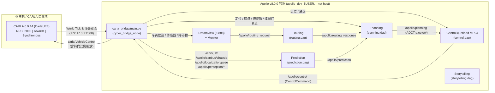

# Apollo v8.0.0 + CARLA 0.9.14 联合仿真入门与完整部署指南

本文档面向 **Ubuntu 22.04（x86_64）** 物理机环境，完整梳理了从零部署、编译、配置调优到跑通 **CARLA 0.9.14 + `apollo_bridge`（`carla_bridge`）+ Apollo `v8.0.0`** 闭环自动驾驶联合仿真的全部步骤，并包含实际验证过程中踩过的全部坑点与对应修复方案。

> 本指南基于仓库验证基线（[Apollo `v8.0.0`](https://github.com/ApolloAuto/apollo/tree/v8.0.0) + [CARLA `0.9.14`](https://github.com/carla-simulator/carla/tree/0.9.14)）编写。常见问题与报错排查请参阅 [常见问题与排障手册](Troubleshooting.md)，控制器调优说明请参阅 [改进控制器与示例视频](RefinedController.md)。

---

## 1. 系统定位与数据流架构

`carla_bridge` 运行在 Apollo 容器的 CyberRT 环境中，同时作为 CARLA 的 Python RPC 客户端（默认连接 `172.17.0.1:2000`）与 Apollo 的 CyberRT 节点（`cyber_bridge_node`），以 `synchronous_mode: True`、`fixed_delta_seconds: 0.05`（20 Hz）同步推进仿真并双向翻译数据与控制指令：



### 双向 CyberRT Topic 对照表

| Topic 名称 | 方向 | Protobuf 消息类型 | 源码位置 | 说明 |
| :--- | :--- | :--- | :--- | :--- |
| `/clock` | 桥 → Apollo | `cyber.proto.clock_pb2.Clock` | `carla_bridge/main.py` | 仿真同步时钟 |
| `/apollo/canbus/chassis` | 桥 → Apollo | `Chassis` | `carla_bridge/actor/ego_vehicle.py` | 车速、油门/刹车/转向反馈、默认发布 `COMPLETE_AUTO_DRIVE` |
| `/apollo/localization/pose` | 桥 → Apollo | `LocalizationEstimate` | `carla_bridge/actor/ego_vehicle.py` | 自车 ENU 位姿、速度、角速度、加速度真值 |
| `/apollo/localization/msf_status` | 桥 → Apollo | `LocalizationStatus` | `carla_bridge/actor/ego_vehicle.py` | 定位状态消息 |
| `/tf` | 桥 → Apollo | `TransformStampeds` | `carla_bridge/actor/ego_vehicle.py` | `world -> localization` 坐标变换 |
| `/apollo/perception/obstacles` | 桥 → Apollo | `PerceptionObstacles` | `carla_bridge/sensor/object_sensor.py` | 仿真世界障碍物真值 |
| `/apollo/perception/traffic_light` | 桥 → Apollo | `TrafficLightDetection` | `carla_bridge/sensor/traffic_lights_sensor.py` | 红绿灯状态真值 |
| `/apollo/sensor/camera/<id>/image*` | 桥 → Apollo | `Image` / `CompressedImage` | `carla_bridge/sensor/camera.py` | 前视相机（默认 `front_6mm`、`front_12mm`） |
| `/apollo/sensor/<id>/compensator/PointCloud2` | 桥 → Apollo | `PointCloud` | `carla_bridge/sensor/lidar.py` | 128 线激光雷达点云（默认 `lidar128`） |
| `/apollo/sensor/radar/front` | 桥 → Apollo | `ContiRadar` | `carla_bridge/sensor/radar.py` | 毫米波雷达目标 |
| `/apollo/sensor/gnss/*` | 桥 → Apollo | `GnssBestPose` / `Gps` / `Heading` / `InsStat` / `CorrectedImu` | `carla_bridge/sensor/gnss.py`、`imu.py` | GNSS 与 IMU 数据 |
| `/apollo/control` | Apollo → 桥 | `ControlCommand` | `carla_bridge/actor/ego_vehicle.py` | 接收 Apollo 油门/刹车/转向；内部对左转乘 `0.85`、右转乘 `0.7` 抑制转向过冲 |

> **关键原则**：由于 `carla_bridge` 直接发布定位真值与感知真值（`/apollo/localization/pose`、`/apollo/perception/*`），联调时**切勿**开启 Apollo 的 MSF `Localization`、相机/雷达 `Perception`、`Canbus` 或传感驱动模块，只需启动 **`Routing`、`Prediction`、`Planning`、`Control`、`Storytelling`** 即可。

---

## 2. 前置软硬件环境准备

| 组件 | 推荐配置 | 说明 |
| :--- | :--- | :--- |
| **操作系统** | Ubuntu 20.04 / 22.04（x86_64） | 若使用 Wayland 会话，需留意混合显卡驱动与 Vulkan ICD 选择 |
| **磁盘空间** | 可用空间 **>= 60 GiB** | Apollo 开发镜像（解压约 23 GiB）+ 源码与局部编译产物 + CARLA 0.9.14（解压约 16 GiB） |
| **内存 + Swap** | 物理内存 **>= 14 GiB** + Swap **>= 16 GiB** | 合计建议 >= 30 GiB，防止 Bazel 编译时 OOM |
| **Docker** | Docker + Docker Compose v2（`docker compose`） | 建议将当前用户加入 `docker` 用户组（免 `sudo` 执行 `docker`） |
| **GPU 支持** | NVIDIA GPU + `nvidia-container-toolkit` | 若使用 RTX 40 系列（Compute Capability `8.9`）配合 Apollo 8.0 默认 CUDA 11.1 容器，需采用 CPU 编译以规避不支持 `compute_89` 的编译失败 |

安装 Docker 与 NVIDIA Container Toolkit（如已就绪可跳过）：

```bash
# 1. 安装 Docker Engine 与 Docker Compose 插件
curl -fsSL https://get.docker.com | sh
sudo systemctl enable --now docker
sudo usermod -aG docker "$USER"   # 完成后重新登录终端生效

# 2. 安装 NVIDIA Container Toolkit 并重启 Docker
distribution=$(. /etc/os-release; echo "${ID}${VERSION_ID}")
curl -fsSL https://nvidia.github.io/libnvidia-container/gpgkey \
  | sudo gpg --dearmor -o /usr/share/keyrings/nvidia-container-toolkit-keyring.gpg
curl -s -L "https://nvidia.github.io/libnvidia-container/${distribution}/libnvidia-container.list" \
  | sed 's#deb https://#deb [signed-by=/usr/share/keyrings/nvidia-container-toolkit-keyring.gpg] https://#g' \
  | sudo tee /etc/apt/sources.list.d/nvidia-container-toolkit.list
sudo apt-get update && sudo apt-get install -y nvidia-container-toolkit
sudo nvidia-ctk runtime configure --runtime=docker
sudo systemctl restart docker
```

> **网络提示**：若终端环境设置了 `http_proxy` / `https_proxy` 且在 `git clone` 或拉取镜像时出现 `gnutls_handshake() failed` / TLS `EOF` 断流，可改用 `env -u http_proxy -u https_proxy -u HTTP_PROXY -u HTTPS_PROXY` 直连重试。

---

## 3. 部署与编译 Apollo v8.0.0

下文用 `<WORKDIR>` 代指工作父目录（例如 `$HOME/workspace`），用 `apollo_dev_$USER` 代指容器名称。

### 3.1 克隆代码仓库

```bash
mkdir -p <WORKDIR> && cd <WORKDIR>

# 1. 克隆本仿真桥仓库
git clone https://github.com/OpenHUTB/apollo_bridge.git <WORKDIR>/apollo_bridge

# 2. 浅克隆 Apollo v8.0.0 源码（仅拉取 v8.0.0 tag，显著节省空间与时间）
env -u http_proxy -u https_proxy -u HTTP_PROXY -u HTTPS_PROXY \
  git clone --depth 1 --branch v8.0.0 https://github.com/ApolloAuto/apollo.git <WORKDIR>/apollo
```

### 3.2 拉取开发镜像并启动容器

Apollo 官方 `bash docker/scripts/dev_start.sh` 默认会额外拉取 Sunnyvale 地图与 8 个感知/音频模型大容量数据卷（易触发 Docker Hub TLS EOF 且占用数 GB 磁盘）。在仿真实战中这些地图/模型卷并不需要，推荐直接拉取基础开发镜像并用等效参数创建容器（保留 `--net host`、`--pid=host` 与 `--shm-size 2G`）：

```bash
# 1. 拉取 Apollo v8.0.0 开发镜像（压缩约 7.75 GB，解压约 23.17 GB）
docker pull apolloauto/apollo:dev-x86_64-18.04-20221124_1708

# 2. 创建必要目录并启动容器 apollo_dev_$USER
mkdir -p <WORKDIR>/apollo/.cache "$HOME/.apollo"
docker run -itd \
  --gpus all \
  --privileged \
  --name "apollo_dev_${USER}" \
  -e DISPLAY="${DISPLAY:-:0}" \
  -e DOCKER_USER="$USER" \
  -e USER="$USER" \
  -e DOCKER_USER_ID="$(id -u)" \
  -e DOCKER_GRP="$(id -g -n)" \
  -e DOCKER_GRP_ID="$(id -g)" \
  -e DOCKER_IMG="apolloauto/apollo:dev-x86_64-18.04-20221124_1708" \
  -e USE_GPU_HOST="1" \
  -e NVIDIA_VISIBLE_DEVICES=all \
  -e NVIDIA_DRIVER_CAPABILITIES=compute,video,graphics,utility \
  -v "$HOME/.apollo:$HOME/.apollo" \
  -v "<WORKDIR>/apollo:/apollo" \
  -v /dev:/dev \
  -v /media:/media \
  -v /tmp/.X11-unix:/tmp/.X11-unix:rw \
  -v /etc/localtime:/etc/localtime:ro \
  -v /usr/src:/usr/src \
  -v /lib/modules:/lib/modules \
  -v /dev/null:/dev/raw1394 \
  --net host \
  -w /apollo \
  --add-host "in-dev-docker:127.0.0.1" \
  --add-host "$(hostname):127.0.0.1" \
  --hostname "in-dev-docker" \
  --shm-size "2G" \
  --pid=host \
  apolloauto/apollo:dev-x86_64-18.04-20221124_1708 \
  /bin/bash

# 3. 初始化容器内用户与 Bazel 配置（以 root 跑一次用户映射，再用普通用户初始化）
docker exec -u root "apollo_dev_${USER}" bash -c '/apollo/scripts/docker_start_user.sh'
docker exec -u "$USER" -e HOME="/home/${USER}" -e USER="$USER" "apollo_dev_${USER}" bash -c 'cd /apollo && ./apollo.sh config -n'
```

> 若网络畅通且磁盘充裕，也可使用原生 `cd <WORKDIR>/apollo && bash docker/scripts/dev_start.sh -f -y`（切勿盲目加 `-g cn` 镜像源，部分环境下百度云镜像可能 TLS EOF），注意 `-g` 若未配置或卡卷可退回上述等效 `docker run`。

### 3.3 部署 `carla_bridge` 依赖与高精地图

```bash
cp -r <WORKDIR>/apollo_bridge/carla_bridge <WORKDIR>/apollo/modules/carla_bridge

docker exec -u "$USER" -e HOME="/home/${USER}" -e USER="$USER" "apollo_dev_${USER}" bash -c '
  cd /apollo/modules/carla_bridge
  chmod +x install.sh
  ./install.sh
'
```

`install.sh` 会自动完成：
1. 将 `carla_town01`、`carla_town02`、`carla_town04`、`carla_town07`、`carla_town10hd` 5 张高精地图复制到 `/apollo/modules/map/data/`；
2. 安装 Python 依赖（`loguru==0.7.0`、`networkx`、`transforms3d==0.4.1`）到容器普通用户目录 `~/.local/lib/python3.6/site-packages`；
3. 向容器内 `~/.bashrc` 写入 `PYTHONPATH`（含 `/apollo/modules/carla_bridge/carla_api/carla-0.9.14-py3.7-linux-x86_64.egg`）。

> **Python 3.6.9 兼容说明**：Apollo `v8.0.0` 开发镜像默认使用 Python `3.6.9`，经实测 `carla-0.9.14-py3.7-linux-x86_64.egg` 中的 `libcarla.cpython-37m-x86_64-linux-gnu.so` 在容器内可直接 `import carla` 并稳定连接 CARLA 0.9.14。后续必须保持以 **`-u "$USER" -e HOME="/home/${USER}"`**（而非 `root`）启动 `carla_bridge`，否则会找不到 `transforms3d`。

### 3.4 精简模块化编译 Apollo

全量编译包含 `perception` 大模型与全部单元测试，极易触发 **OOM / 爆盘**；此外，RTX 40 系列（`compute_89`）在 Apollo 8.0 默认 CUDA 11.1 环境下会报错。因此推荐采用 `--config=cpu` 禁用冗余磁盘缓存（`--disk_cache=`），按需仅编译联合仿真所需核心目标（实测 `3492` actions，内存与磁盘可控）：

```bash
docker exec -u "$USER" -e HOME="/home/${USER}" -e USER="$USER" "apollo_dev_${USER}" bash -c '
  cd /apollo && source /apollo/cyber/setup.bash
  bazel build --config=cpu --disk_cache= --copt=-mavx2 --host_copt=-mavx2 --jobs=6 --local_ram_resources=8192 \
    //cyber/mainboard:mainboard \
    //cyber/tools/... \
    //cyber/python/cyber_py3/... \
    //cyber/python/internal:_cyber_wrapper.so \
    //cyber/python/internal:_cyber_time_wrapper.so \
    //cyber/python/internal:_cyber_timer_wrapper.so \
    //cyber/python/internal:_cyber_parameter_wrapper.so \
    //cyber/python/internal:_cyber_record_wrapper.so \
    //cyber/proto/... \
    //modules/common_msgs/... \
    //modules/data/proto/... \
    //modules/dreamview:dreamview \
    //modules/monitor:libmonitor.so \
    //modules/routing:librouting_component.so \
    //modules/localization/rtk:librtk_localization_component.so \
    //modules/localization/msf:libmsf_localization_component.so \
    //modules/prediction:libprediction_component.so \
    //modules/planning:libplanning_component.so \
    //modules/control:libcontrol_component.so \
    //modules/transform:libstatic_transform_component.so \
    //modules/storytelling:libstorytelling_component.so
'
```

> 若使用旧架构 NVIDIA GPU（如 Turing/Ampere，CUDA 11.1 支持其算力）且磁盘与内存充裕，也可按原生方式执行 `./apollo.sh build_gpu`。

---

## 4. 关键配置与必做补丁（确保控制器、Dreamview 与待命状态全部正确）

在编译与运行过程中，仓库原始配置在 Apollo `v8.0.0` 下存在多处必须修改的兼容问题，请务必在 `<WORKDIR>/apollo` 中按以下 7 步逐一落实：

### 4.1 合入调优控制器并修复头文件与参数

```bash
# 1. 合入仓库自带的 refined_controller（如计划重编译后再修改则一起执行）
cp <WORKDIR>/apollo_bridge/carla_bridge/refined_controller/control_conf.pb.txt \
   <WORKDIR>/apollo/modules/control/conf/control_conf.pb.txt
cp <WORKDIR>/apollo_bridge/carla_bridge/refined_controller/mpc_controller.cc \
   <WORKDIR>/apollo/modules/control/controller/mpc_controller.cc
cp <WORKDIR>/apollo_bridge/carla_bridge/refined_controller/mpc_controller.h \
   <WORKDIR>/apollo/modules/control/controller/mpc_controller.h
```

1. **修正 `mpc_controller.h` 第 29 行头文件路径**（原文件沿用了 Apollo 6/7 路径，v8.0.0 编译会报找不到文件）：
   修改 `<WORKDIR>/apollo/modules/control/controller/mpc_controller.h`：
   ```cpp
   // 原内容：#include "modules/common/configs/proto/vehicle_config.pb.h"
   #include "modules/common_msgs/config_msgs/vehicle_config.pb.h"
   ```

2. **修复 Control 永久急停锁死 & 待命/到站 15.7% 蠕行问题**：
   修改 `<WORKDIR>/apollo/modules/control/conf/control_conf.pb.txt` 两处：
   - 在顶部 `enable_input_timestamp_check: false` 下方添加：
     ```protobuf
     enable_persistent_estop: false
     ```
     > **原因**：`control_conf.proto` 默认 `enable_persistent_estop: true`。下发路由前空轨迹或 `not_ready` 状态会让 `estop_` 永久锁死在 `brake = 50, throttle = 0`，即使后续下发合法路线也无法起步。
   - 在文件后半段 `mpc_controller_conf { ... }` 中（约第 9383 行），将 `standstill_acceleration: -0.3` 改为 `-1.0`：
     ```protobuf
     mpc_controller_conf {
       ...
       max_lateral_acceleration: 5.0
       standstill_acceleration: -1.0
     ```
     > **原因**：`mpc_controller_conf.calibration_table` 在 `speed: 0.0` 处直接从 `(acceleration: -0.48, command: -2.82)` 跳变到 `(acceleration: 0.09, command: 30.06)`。取 `-0.3` 时线性插值会得到正值 `+7.56`，再经 `vehicle_param_.throttle_deadzone()`（`15.7`）钳位后输出 `15.7%` 油门，导致车辆到达终点停车时继续向前滑行蠕动；设为 `-1.0` 后插值为负，稳稳输出制动（`brake >= 14.5%`）。

3. **在 `control_component.cc` 中增加 `not_ready` 制动保持**：
   在 `<WORKDIR>/apollo/modules/control/control_component.cc` 的 `if (local_view_.trajectory().trajectory_point().empty()) { ... }` 判断后（约第 212 行）追加：
   ```cpp
   if (local_view_.trajectory().decision().main_decision().has_not_ready()) {
     AWARN_EVERY(100) << "planning is not ready.";
     estop_ = true;
     estop_reason_ = "estop for planning not ready";
   }
   ```
   > **原因**：无路由待命时 Planning 发出的 30 点静态轨 `trajectory_type` 为 `UNKNOWN (0)`，会绕过 `mpc_controller.cc` 中仅对 `NORMAL` 生效的停驻保护并触发 `15.7%` 蠕行。加入上述逻辑并配合 `enable_persistent_estop: false`，待命期可靠刹停（`drift = 0.0000 m, brake = 50.0`），下发路由后首帧即刻松刹起步。

4. **增量重编 Control 组件**：
   ```bash
   docker exec -u "$USER" -e HOME="/home/${USER}" -e USER="$USER" "apollo_dev_${USER}" bash -c '
     cd /apollo && source /apollo/cyber/setup.bash
     bazel build --config=cpu --disk_cache= --copt=-mavx2 --host_copt=-mavx2 --jobs=6 --local_ram_resources=8192 \
       //modules/control:libcontrol_component.so
   '
   ```

### 4.2 配置默认地图与精简 HMI 模式（彻底消除安全模式红框）

1. **设置默认启动地图为 `carla_town01`**：
   编辑 `<WORKDIR>/apollo/modules/common/data/global_flagfile.txt`，保证末尾为单条（避免重复 `--map_dir` 堆积）：
   ```text
   --map_dir=/apollo/modules/map/data/carla_town01
   ```

2. **创建精简 5 模块 HMI 模式 `carla_bridge.pb.txt`**：
   Apollo 的 `hmi_mode.proto` 默认所有模块 `required_for_safety: true`，而 `carla_bridge` 会持续发布 `COMPLETE_AUTO_DRIVE`。如果继续使用 `Mkz Standard Debug`，只要实车硬件/感知/CANBus 等 10 余个模块未开启，`FunctionalSafetyMonitor` 就会触发 `Storytelling triggers safe mode:` 红框及 `System fault. Auto disengage.` 告警。

   新建 `<WORKDIR>/apollo/modules/dreamview/conf/hmi_modes/carla_bridge.pb.txt`：
   ```protobuf
   cyber_modules {
     key: "Routing"
     value: {
       dag_files: "/apollo/modules/routing/dag/routing.dag"
     }
   }
   cyber_modules {
     key: "Prediction"
     value: {
       dag_files: "/apollo/modules/prediction/dag/prediction.dag"
     }
   }
   cyber_modules {
     key: "Planning"
     value: {
       dag_files: "/apollo/modules/planning/dag/planning.dag"
     }
   }
   cyber_modules {
     key: "Control"
     value: {
       dag_files: "/apollo/modules/control/dag/control.dag"
     }
   }
   cyber_modules {
     key: "Storytelling"
     value: {
       dag_files: "/apollo/modules/storytelling/dag/storytelling.dag"
     }
   }
   ```

3. **预置 `Carla Town01` 一键路由终点（避免人工选点误触路肩）**：
   新建 `<WORKDIR>/apollo/modules/map/data/carla_town01/default_end_way_point.txt`（以下 3 个主车道地标均已通过 Dreamview `CheckRoutingPoint` 合法性校验）：
   ```protobuf
   landmark {
     name: "Town01 North Road"
     waypoint {
       pose {
         x: 245.630
         y: -1.965
       }
     }
   }

   landmark {
     name: "Town01 East Straight"
     waypoint {
       pose {
         x: 396.303
         y: -158.540
       }
     }
   }

   landmark {
     name: "Town01 South Road"
     waypoint {
       pose {
         x: 221.620
         y: -330.603
       }
     }
   }
   ```

4. **（可选）降低相机渲染负载**：
   若仅做规控联调且希望进一步降低 GPU 负载，可修改 `<WORKDIR>/apollo/modules/carla_bridge/config/objects.json` 中 `front_6mm` 与 `front_12mm` 两个相机的分辨率与帧率（其余雷达、GNSS、IMU 与真值传感器保持不变）：
   ```json
   "image_size_x": 640,
   "image_size_y": 480,
   "sensor_tick": 0.2
   ```

---

## 5. 部署与启动 CARLA 0.9.14（两种方式）

### 方式 A：宿主机原生运行 CARLA 0.9.14（推荐，免去镜像拉取限速与容器显卡映射问题）

1. 下载并解压官方 [CARLA_0.9.14.tar.gz](https://carla-releases.s3.us-east-2.amazonaws.com/Linux/CARLA_0.9.14.tar.gz) 到 `<WORKDIR>/CARLA_0.9.14`：
   ```bash
   mkdir -p <WORKDIR>/CARLA_0.9.14
   tar -xzf CARLA_0.9.14.tar.gz -C <WORKDIR>/CARLA_0.9.14
   ```
2. **补齐缺失的 `libomp.so.5`（支持无 `sudo` 环境）**：
   Ubuntu 22.04 默认未安装 `libomp5`，直接运行会报 `libomp.so.5: cannot open shared object file`：
   ```bash
   # 有 sudo 时：
   sudo apt-get update && sudo apt-get install -y libomp5

   # 若无 sudo 权限，可局部解包注入 LD_LIBRARY_PATH：
   mkdir -p <WORKDIR>/CARLA_0.9.14/extra_libs && cd <WORKDIR>/CARLA_0.9.14/extra_libs
   apt-get download libomp5-14
   dpkg-deb -x libomp5-14_*.deb . && rm -f libomp5-14_*.deb
   ```
3. **启动 CARLA 0.9.14**：
   - **常规 NVIDIA 独显设备**（Xorg 桌面或独立独显）：
     ```bash
     LIBOMP_DIR=$(dirname "$(find <WORKDIR>/CARLA_0.9.14/extra_libs -name 'libomp.so.5' 2>/dev/null | head -n 1)")
     cd <WORKDIR>/CARLA_0.9.14
     LD_LIBRARY_PATH="${LIBOMP_DIR:+$LIBOMP_DIR:}${LD_LIBRARY_PATH:-}" \
     DISPLAY="${DISPLAY:-:0}" \
     VK_ICD_FILENAMES=/usr/share/vulkan/icd.d/nvidia_icd.json \
     __NV_PRIME_RENDER_OFFLOAD=1 \
     __GLX_VENDOR_LIBRARY_NAME=nvidia \
     ./CarlaUE4.sh -prefernvidia -nosound -windowed -ResX=800 -ResY=600 -quality-level=Low -carla-rpc-port=2000 \
       > <WORKDIR>/carla_0.9.14.log 2>&1 &
     ```
   - **AMD+NVIDIA 双显卡笔记本 + Wayland 环境避坑提示**：
     若在 NVIDIA `595.xx` 等新版驱动下，跑车约 30 秒触发内核 `NVRM: Xid 31 ... FAULT_PDE` 及 `VK_ERROR_DEVICE_LOST` 闪退，请去掉 `__NV_PRIME_RENDER_OFFLOAD` 与 `-prefernvidia`，改用 **AMD 核显 RADV Vulkan** 启动（经 62 秒高速压测零故障且保留 3D 窗口）：
     ```bash
     LIBOMP_DIR=$(dirname "$(find <WORKDIR>/CARLA_0.9.14/extra_libs -name 'libomp.so.5' 2>/dev/null | head -n 1)")
     cd <WORKDIR>/CARLA_0.9.14
     LD_LIBRARY_PATH="${LIBOMP_DIR:+$LIBOMP_DIR:}${LD_LIBRARY_PATH:-}" \
     DISPLAY="${DISPLAY:-:0}" \
     VK_ICD_FILENAMES=/usr/share/vulkan/icd.d/radeon_icd.x86_64.json \
     ./CarlaUE4.sh -nosound -windowed -ResX=800 -ResY=600 -quality-level=Low -carla-rpc-port=2000 \
       > <WORKDIR>/carla_0.9.14.log 2>&1 &
     ```
   - 如不需要 3D 桌面窗口（纯服务器/无头模式），可改为添加 `-RenderOffScreen`。

### 方式 B：使用 Docker 运行 CARLA 0.9.14

本仓库的 CARLA Compose 文件位于 `carla_scripts/` 目录下：

```bash
cd <WORKDIR>/apollo_bridge/carla_scripts
# Docker Compose v2：
docker compose -f carla-compose.yml -p carla up -d
# （若系统安装的是独立 docker-compose v1，可执行 ./docker_run_carla.sh）
```

---

## 6. 联合仿真标准启动与交互操作手册（SOP）

### 6.1 四步启动完整环境

```bash
# 第 1 步：启动容器、Monitor 与 Dreamview（http://localhost:8888/）
# 注意：必须在 source /apollo/scripts/apollo_base.sh 后将 libtorch_cpu 前置到 LD_LIBRARY_PATH，
# 并直接调用 start monitor && start dreamview（不要运行 ./scripts/dreamview.sh，
# 否则子脚本会重新 source apollo.bashrc，在含 NVIDIA GPU 的机器上重新前置 libtorch_gpu，导致网页开关模块失效）
docker start "apollo_dev_${USER}"
docker exec -u "$USER" -e HOME="/home/${USER}" -e USER="$USER" "apollo_dev_${USER}" bash -c '
  cd /apollo
  ./scripts/bootstrap.sh stop >/dev/null 2>&1 || true
  source /apollo/scripts/apollo_base.sh
  export LD_LIBRARY_PATH="/usr/local/libtorch_cpu/lib:${LD_LIBRARY_PATH}"
  start monitor
  start dreamview
'

# 第 2 步：按第 5 节启动 CARLA 0.9.14，等待 TCP 2000 端口监听就绪（约 5~10 秒）

# 第 3 步：启动 carla_bridge（必须指定 -u "$USER" 并注入 libtorch_cpu 与 PYTHONPATH）
docker exec -d -u "$USER" -e HOME="/home/${USER}" -e USER="$USER" "apollo_dev_${USER}" bash -c '
  cd /apollo/modules/carla_bridge
  source /apollo/cyber/setup.bash
  export LD_LIBRARY_PATH="/usr/local/libtorch_cpu/lib:${LD_LIBRARY_PATH}"
  export PYTHONPATH="/apollo/cyber:/apollo/cyber/python:/apollo:/apollo/modules:/apollo/modules/carla_bridge/carla_api/carla-0.9.14-py3.7-linux-x86_64.egg:/apollo/bazel-bin:/apollo/bazel-bin/cyber/python/internal"
  mkdir -p /apollo/data/log
  exec python3 main.py > /apollo/data/log/carla_bridge.log 2>&1
'
# 等待约 7~12 秒，确认日志出现 "All objects spawned."
```

> **重启约束**：若 `carla_bridge` 已处于运行状态，不要强杀后直接向同一 CARLA 世界重连 `load_world('Town01')`（CARLA 0.9.14 在同步模式与传感器尚未释放时重连易 `Signal 11`）；停桥应发 `SIGINT` 优雅退出或连同 CARLA 一并重启。

### 6.2 Dreamview 网页交互步骤

在浏览器打开 **`http://localhost:8888/`**：

1. **先确认顶部模式、车型与地图（之后不要再切换）**：
   - 模式选 **`Carla Bridge`**
   - 车型选 **`Mkz Example`**（**切勿选 `Lincoln2017MKZ LGSVL`**，该车型自带未调优的 `control_conf.pb.txt`，会覆盖本地防蠕动和控制参数）
   - 地图选 **`Carla Town01`**
   - **注意**：切换顶部下拉框（模式/车型/地图）时，后端会自动触发 `ResetMode()` 停掉全部模块。如果操作途中切换过，回到上述三项后重新执行第 2 步即可。

2. **在左侧 `Module Controller` 开启核心模块**：
   - 打开以下 **5 个开关**：`Routing`、`Prediction`、`Planning`、`Control`、`Storytelling`。
   - **切勿开启** `Localization`、`Perception`、`Canbus`、`Camera`、`Velodyne` 等模块。
   - 正常状态下不应出现 `Storytelling triggers safe mode:` 红框；未下发路线前，自车位置会出现白色 `STOP` 墙 + 橙色沙漏与右侧 `Brake 50% | 0 km/h`，这是等待路线的正常静止待命画面。

3. **下发导航路线让车辆自动行驶（两种方式）**：
   - **方式一（推荐，一键预设地标）**：
     点击左侧 **`Tasks`** → 在下方 **Default Routings**（或 **Default Routing**）中选择 **`Town01 East Straight`**、**`Town01 North Road`** 或 **`Town01 South Road`**。
   - **方式二（手动地图选点 `Route Editing`）**：
     - 点击左侧 **`Route Editing`**；
     - **不要点击 `Set Start Point`**（系统自动读取自车当前定位与车头朝向）；
     - 只点击 **`Add Point of Interest`**，放大地图并在自车前方**右侧正常行车道（绿色车道中心线内）**左键单击设置终点（注意不要点到边缘白色路肩 `SHOULDER` 或对向车道）；
     - 点击 **`Send Routing Request`**。

4. **效果确认与可选可视化**：
   - 下发路线后，沙漏停止墙会立即消失并出现红色全局路由与蓝绿色规划轨迹，刹车归零、油门抬起，车辆在 CARLA 3D 窗口中沿道路自动行驶。
   - 如需查看传感器画面：可在左侧 **Tasks → Others** 打开 **Camera Sensor**；或在 **Layer Menu → Perception** 打开 **Point Cloud**。

Apollo Dreamview 与 CARLA 联合仿真效果示意：


---

## 7. 状态巡检与安全停机

### 7.1 在线状态检查命令

```bash
# 1. 检查 Dreamview HTTP 服务
curl -sS -o /dev/null -w "Dreamview HTTP=%{http_code}\n" http://127.0.0.1:8888/

# 2. 列出活跃 Cyber 节点与频道
docker exec -u "$USER" "apollo_dev_${USER}" bash -c '
  source /apollo/cyber/setup.bash
  timeout 5 /apollo/bazel-bin/cyber/tools/cyber_node/cyber_node list
  timeout 5 /apollo/bazel-bin/cyber/tools/cyber_channel/cyber_channel list
'
```

### 7.2 实测闭环性能基准

在 `Carla Bridge | Mkz Example | Carla Town01` 下完成的端到端实测参考指标：

- **待命零漂移保持（3.5 秒未下发路线）**：自车位移 `0.0000 m`，车速 `0.0000 m/s`，`Control` 稳定输出 `throttle = 0.00`、`brake = 50.00`，`SystemStatus.require_emergency_stop = False`。
- **Dreamview WebSocket 13 秒短途闭环**：从 `(131.419, -133.428)` 行驶至 `(162.569, -133.519)`（目标 `(166.419, -133.444)`），刹车由 `50.0` 平滑释放至 `0.00`，最高油门 `58.61`，到达终点附近自动施以 `14.5` 制动停稳，最高车速 `3.01 m/s`，累计位移 `31.15 m`。
- **AMD RADV Vulkan 62 秒长途压测**：62.1 秒连续行驶路径 `200.53 m`（净位移 `170.64 m`，最高车速 `19.61 m/s`），`/apollo/localization/pose` 稳定 `10.30 Hz`，`/clock` 稳定 `10.31 Hz`，全程零 GPU 报错与急停告警。

### 7.3 安全停止全部进程（注意 `--pid=host` 保护）

> 由于容器使用 `--pid=host` 共享宿主机进程空间，**切勿**在容器内执行 `pkill -f "python3 main.py"` 等模糊查杀命令；停桥时请先发送 `SIGINT` 让其退出同步模式并销毁传感器。

```bash
# 1. 容器内精确停桥、停规控模块并关闭 Dreamview / Monitor
docker exec -u "$USER" -e HOME="/home/${USER}" -e USER="$USER" "apollo_dev_${USER}" bash -c '
  bridge_pids=$(ps -eo pid,args | grep "python3 main.py" | grep -v grep | awk "{print \$1}")
  if [ -n "$bridge_pids" ]; then kill -INT $bridge_pids 2>/dev/null || true; sleep 2; fi
  for pat in "routing.dag" "prediction.dag" "planning.dag" "control.dag" "storytelling.dag"; do
    pids=$(ps -eo pid,args | grep "$pat" | grep -v grep | awk "{print \$1}")
    if [ -n "$pids" ]; then kill $pids 2>/dev/null || true; fi
  done
  cd /apollo && source /apollo/cyber/setup.bash && ./scripts/bootstrap.sh stop
'

# 2. 宿主机停止原生 CARLA（或使用 carla_scripts/stop_carla.sh 停止 Docker 版）
pids=$(ps -eo pid,args | grep "CarlaUE4-Linux-Shipping" | grep -v grep | awk '{print $1}')
[ -n "$pids" ] && kill $pids 2>/dev/null || true
```
