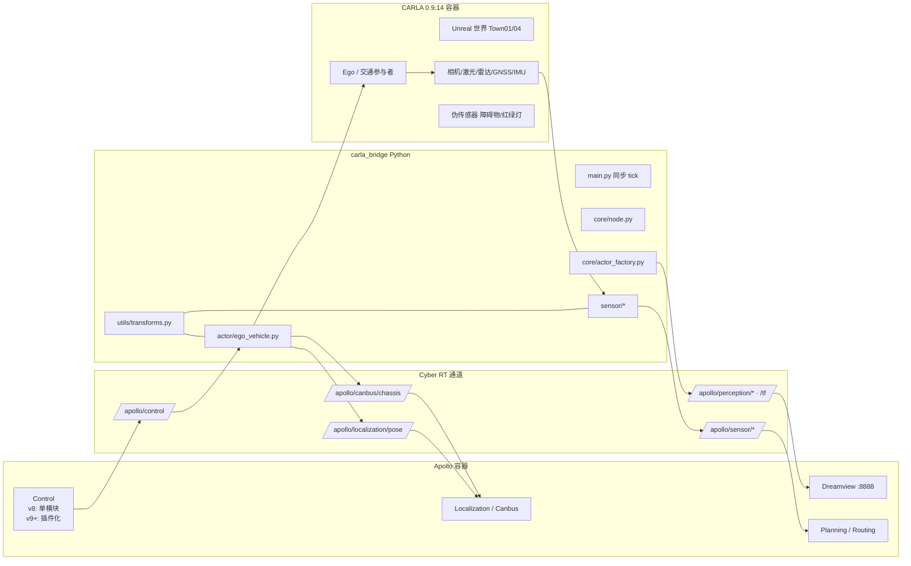
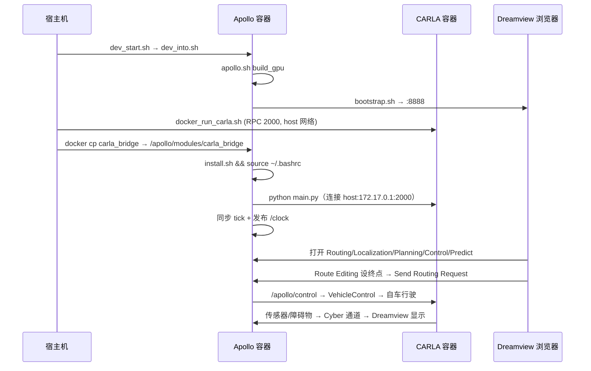
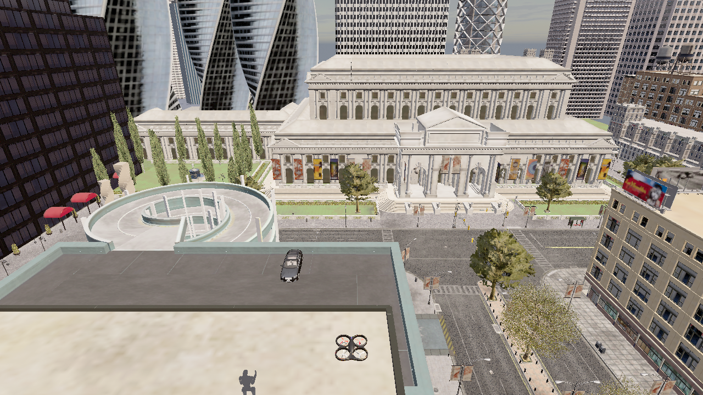

# OpenHUTB–Apollo 仿真桥配置与 Apollo 12 适配记录

> 记录日期：2026-11-21（2026-11-20 初稿）  
> 工作目录：`D:/qing_zhuomian/仿真彭晗老师`  
> 上游仓库：`guardstrikelab/carla_apollo_bridge`，commit `b0c2e088`（2024-09-09）  
> 文档发布仓库：`OpenHUTB/apollo_bridge`（mkdocs）  
> 对应 Issue：[OpenHUTB/apollo_bridge#1](https://github.com/OpenHUTB/apollo_bridge/issues/1)  
> 工具：AOCI-CODE v0.1.1（agent-native 认知索引）

---

## 0. 结论速览（TL;DR）

| 问题 | 结论 |
| --- | --- |
| 任务是什么 | 维护 Apollo 与模拟器之间的仿真桥；先按文档跑通，再把同一座桥跑到 **Apollo 12 + OpenHUTB 最新版（兼容 CARLA 接口）** 上，并用中文文档发布 |
| 官方支持版本 | 上游 README 写明 CARLA 0.9.14 + Apollo v8.0.0；Issue #1 要求改成 OpenHUTB 最新版 + Apollo 12 |
| 本机硬件 | **RTX 4050 Laptop GPU，6141 MiB，驱动 592.00 / CUDA 13.1**；`nvidia-smi` 正常，WSL2 内也能直通 |
| 本机 Linux 环境 | WSL2 Ubuntu 22.04 曾跑通（Docker 29.1.3、GPU 直通），但 Bazel 编译会让 WSL 整机重启；为腾出 37 GB 解压 OpenHUTB，已 `wsl --unregister` 删除该发行版，Apollo 环境需在原生 Ubuntu 重建 |
| 为什么不用 Docker Desktop | Docker Desktop 在 Windows Home 上反复因 `sailor-ingest.sock` 句柄 `Access is denied` 起不来；已改用 WSL2 内的原生 Docker Engine；该方案验证可行 |
| 已经做到什么 | AOCI-CODE 58 条认知条目；7 项离线冒烟验证；中文文档 + mkdocs 6 页；**OpenHUTB 2.10.1 已在本机 Windows 原生跑起来（Town10HD，RPC 2000，24 个 actor）** |
| 还差什么 | Apollo 8 镜像/容器/桥曾就位，但编译会让 WSL2 整机重启（2–4 分钟必现）→ **需要原生 Ubuntu 主机**；Apollo 12 需要老师提供内部源码或镜像 |
| 文档发布 | 已合入 `OpenHUTB/apollo_bridge` 本地分支，`mkdocs build` 通过（6 页）；按协作规则**尚未 push**，等你授权 |
| Apollo 12 现状 | 截至 2026-11-21，Apollo 公开 tag 最高为 `v11.0.0`，**没有公开的 v12 源码或 tag**；v12 方案基于 v9–v11 架构演进推导，需拿到内部预览版后用 `tools/probe_apollo12.sh` 复核 |
| 适配难点 | ① 桥主体依赖的 18 个 proto 在 v8/v11 都存在，`ControlCommand` 字段稳定 → 风险低；② 控制架构从 v9 起插件化（pipeline + plugins.xml），原 3 文件替换法失效 → 风险高 |

---

## 1. 背景与任务拆解

百度阿波罗团队需要维护一座连接 Apollo 与模拟器两个生态的仿真桥。Issue #1 的原始要求是：

1. 按照本仓库的文档把仿真桥跑起来，用中文整理好文档并发布；
2. 在 **Apollo 12**（还在百度内部开发）和 **OpenHUTB 最新版**（兼容 CARLA 接口，<https://github.com/OpenHUTB/hutb>）上跑起来。

相比最初的表述，这里有两个关键变化，后续工作全部以此为准：

- 模拟器侧从 **CARLA 0.9.14** 换成 **OpenHUTB 最新版**（CARLA 接口兼容）；
- 交付物除了代码，还包括**在 `OpenHUTB/apollo_bridge` 里发布的中文文档站**（mkdocs）。

方法上，先用 **AOCI-CODE** 把上游仓库"读厚再读薄"，形成可版本化的认知索引，再据此判断改造面。

### 1.1 当前进度

| 工作项 | 状态 | 证据/位置 |
| --- | --- | --- |
| AOCI 认知索引 | ✅ 完成 | `carla_apollo_bridge/aoci.code.txt`，58 条，`verify`/`check` 全绿 |
| 中文配置文档 | ✅ 完成初稿 | `docs/仿真桥配置与Apollo12适配记录.md` |
| mkdocs 文档站 | ✅ 本地构建通过 | `apollo_bridge_openhutb/site/`，6 个页面 |
| WSL2 Ubuntu 22.04 | ⚠️ 已删除 | 曾跑通 Docker/GPU；为腾 37 GB 解压 OpenHUTB 已 unregister，需重建 |
| WSL2 Docker Engine | ✅ 验证过 | Docker 29.1.3，`hello-world` 成功；方案可行，但宿主机编译会崩 |
| OpenHUTB 模拟器 | ✅ 跑通 | 2.10.1，Town10HD，RPC 2000，24 个 actor；截图见 `docs/images/openhutb_town10hd.png` |
| Apollo 8 开发镜像 | ✅ 曾拉取 | `apolloauto/apollo:dev-x86_64-18.04-20221124_1708`，23.2 GB（随 WSL 删除） |
| Apollo 8 基线编译 | ❌ 本机不可行 | Bazel 持续编译会让 WSL2 整机重启；改用 `tools/bootstrap_apollo_bridge_ubuntu.sh` 在原生 Ubuntu 上跑 |
| Apollo 12 联调 | ⏳ 等内部预览版 | 探测脚本 `tools/probe_apollo12.sh` 已就绪 |

---

## 2. 用 AOCI-CODE 理解仓库

### 2.1 安装与索引建立过程

AOCI-CODE 是 Go 写的 CLI/MCP Server，把源码蒸馏成纯文本认知索引（`aoci.txt` / `aoci.meta.txt` / `aoci.code.txt`）。本机无 Go，直接下载官方 Windows 二进制并校验 SHA256：

```bash
gh release download v0.1.1 -R aoci-spec/aoci-code \
  -p "aoci_0.1.1_windows_amd64.zip" -p "SHA256SUMS"
sha256sum -c <(grep "aoci_0.1.1_windows_amd64.zip$" SHA256SUMS)   # OK
unzip -o aoci_0.1.1_windows_amd64.zip -d .tools/aoci/bin
```

针对本仓库初始化后，AOCI 提示 `index=92`，其中包含 106 MB 地图二进制、28 MB CARLA egg、23 MB 演示图片。这些不是人工源码，因此在**首次 scan 之前**把它们降为 `observe`：

```bash
aoci --repo . init --locale zh-CN --scope-profile production
aoci --repo . scope rule add bridge-generated-maps --action observe \
     --pattern 'carla_bridge/map/**' --pattern-kind glob --order 200 --reason '自动生成地图'
aoci --repo . scope rule add bridge-carla-egg --action observe \
     --pattern 'carla_bridge/carla_api/*.egg' --pattern-kind glob --order 201 --reason '预编译二进制'
aoci --repo . scope rule add bridge-demo-images --action observe \
     --pattern 'docs/images/**' --pattern-kind glob --order 202 --reason '演示图片'
aoci --repo . scan
aoci --repo . scope approval-mode auto
aoci --repo . scope activate
```

裁剪后：`index=62`、`observe=34`、`exclude=6`。随后通过 MCP 的 `aoci_maintain` 分三批领取候选（24 + 24 + 10），按 FRAS v2 预算规则撰写条目并用 `aoci_update_entry` 原子提交。

**最终状态：**

```text
索引条目 58 | verify: Volumes v1 结构有效 | check: ✓ 可提交（五净）
S 覆盖: C7+ 条目 20/20 有 S | Guide: stage=aligned, complete=true, next_action=none
```

索引文件：`carla_apollo_bridge/aoci.code.txt`（58 条），标签字典在 `aoci.meta.txt`，治理状态在 `.aoci/`。

### 2.2 分层架构




四层职责：

| 层 | 关键文件 | 职责 | 版本敏感度 |
| --- | --- | --- | --- |
| 入口/调度 | `main.py`、`core/node.py` | 读 `settings.yaml`，连接 CARLA，起同步 tick 线程，发布 `/clock`，finally 恢复现场 | 低 |
| Actor 管理 | `core/actor_factory.py`、`core/carla_spawn_objects.py`、`config/objects.json` | 按蓝图生成自车/交通参与者/传感器，注册 Cyber reader/writer，异步处理增删 | 低 |
| 控制下行 | `actor/ego_vehicle.py` | 订阅 `/apollo/control`，`throttle/brake = 值/100`，`steer = -(steering_target × ratio)/100`，`hand_brake = parking_brake`，`reverse = gear==GEAR_REVERSE` | 低（字段稳定） |
| 感知上行 | `sensor/*.py`、`actor/traffic_participant.py`、`utils/transforms.py` | 相机/激光/雷达/GNSS/IMU/伪障碍物/红绿灯 → Apollo 消息；左手系 y 取负、yaw+90 修正 | 中（topic 名可能变） |

### 2.3 核心数据闭环

| 方向 | Cyber 通道 | 消息类型 | 生产者 → 消费者 |
| --- | --- | --- | --- |
| 下行 | `/apollo/control` | `ControlCommand` | Apollo Control → `EgoVehicle.control_reader` |
| 上行 | `/apollo/canbus/chassis` | `Chassis` | `EgoVehicle` → Apollo Canbus/Localization |
| 上行 | `/apollo/localization/pose`、`/apollo/localization/msf_status` | `LocalizationEstimate` / `LocalizationStatus` | `EgoVehicle` |
| 上行 | `/apollo/sensor/camera/<name>/image/compressed` | `CompressedImage` | `Camera`（仅 compressed 实际写出） |
| 上行 | `/apollo/sensor/<name>/compensator/PointCloud2` | `PointCloud` | `Lidar` |
| 上行 | `/apollo/sensor/gnss/corrected_imu` | `CorrectedImu` | `Imu`（topic 硬编码） |
| 上行 | `/apollo/sensor/<name>` | `ContiRadar` | `Radar` |
| 上行 | `/apollo/perception/<name>`、`/apollo/perception/traffic_light` | `PerceptionObstacles` / `TrafficLightDetection` | 伪传感器 |
| 双向 | `/tf` | `TransformStampeds` | `EgoVehicle`，注意 `write_tf` 中 sendTransform 被注释 |

### 2.4 AOCI 索引揭示的关键约束（容易踩的坑）

1. **转向比例是调优常量**：`ego_vehicle.py` 里 `right_turn_ratio=0.7`、`left_turn_ratio=0.85`，默认值会让弯道过冲；这是精调控制器文档要求配合调整的参数。
2. **`steering_rate` 算了没用**：代码计算了 `rate` 但从未应用到 `VehicleControl`。
3. **图像只发 compressed**：`Image` 与 DVS `events` 的 write 被注释，调试时不要等 `/image`。
4. **IMU / SemanticLidar / 红绿灯 topic 硬编码**：改 `objects.json` 里的 name 不会改变这些 topic；多实例会互相覆盖。
5. **TF 只构造不发送**：`_tf_broadcaster.sendTransform` 被注释。
6. **`Thread.daemo` 拼写错误**：`main.py` 两处使线程不是 daemon，shutdown 后 `join` 可能挂住。
7. **`finally` 无条件 `get_world()`**：连接失败时会二次抛错，掩盖首个异常。
8. **控制补丁是"替换源码"而非配置**：`refined_controller/` 下的 `control_conf.pb.txt`、`mpc_controller.cc/.h` 要覆盖 Apollo 同名文件并重编译。

### 2.5 风险清单

| 风险 | 影响 | 缓解 |
| --- | --- | --- |
| 文档与代码版本不一致 | README 说 Apollo 8，但代码已用 `modules.common_msgs.*`（v8/v11 均存在） | 以代码 import 为准，实机用探测脚本核对 |
| Apollo 12 控制插件化 | 精调 MPC 三文件替换法失效 | 按第 6 节迁移到 pipeline/plugins 结构 |
| 同步模式时钟 | `fixed_delta_seconds=0.05`，`/clock` 由桥发布；时钟错乱会导致控制超时 | 保持 `synchronous_mode: True`，检查 `/clock` 有数据 |
| 网络分段 | CARLA host 网络、Bridge bridge 网络（见 `docs/deployment_introduction.md`） | 三者必须互通，先 `cyber_channel list` 验证 |
| GPU / 显存 | CARLA Low 画质仍需 NVIDIA Container Toolkit | 无 GPU 环境无法验证，需实机 |

---

## 3. 本机环境勘察与实际阻塞

| 检查项 | 实测结果（2026-11-20 17:38 后更新） |
| --- | --- |
| 操作系统 | Windows 10 Home China，build 26200，工作目录 `D:/qing_zhuomian/仿真彭晗老师` |
| git / gh / python | 可用（Python 3.13.12） |
| NVIDIA GPU | **存在**：RTX 4050 Laptop GPU，6141 MiB，驱动 592.00，CUDA 13.1；`nvidia-smi` 可用。此前"无 GPU"的判断未经实测，已更正 |
| Docker | **已安装**：winget 安装 Docker Desktop 4.99.0；CLI 29.9.3 位于 `C:\Program Files\Docker\Docker\resources\bin\docker.exe`，compose/buildx 插件齐全 |
| Docker 守护进程 | **未运行**：`com.docker.service` 为 Stopped/Manual，`docker info` 报 `dockerDesktopLinuxEngine` 管道不存在；`docker desktop start` 挂起 |
| 权限 | 当前 shell **非管理员**；`Start-Service` 失败（无法打开服务），winget 安装时由系统提权完成 |
| WSL | `wsl.exe` 被安全策略列入程序黑名单，当前 Agent 无法调用；`sc.exe` 同样被禁用 |
| 完整联合仿真 | **未执行**：Windows 10 Home 上 Docker Desktop 的 Linux 引擎依赖 WSL2，而 WSL 被安全策略禁止、服务又需管理员权限 |

因此第 4 节是**在合规 Linux 主机（或解除上述阻塞后的 Windows 主机）上可复现的完整配置流程**；第 5 节是本机实际完成的验证。两者的边界在文档中明确区分，不把"设计上可行"写成"已经跑通"。解除阻塞的具体步骤见附录 C。

---

## 4. 官方流程复现（Ubuntu + NVIDIA 主机）

### 4.1 前置依赖

```bash
# Docker 与 NVIDIA Container Toolkit（官方文档方式）
sudo apt-get install -y docker.io
curl https://get.docker.com | sh && sudo systemctl --now enable docker

distribution=$(. /etc/os-release; echo $ID$VERSION_ID)
curl -fsSL https://nvidia.github.io/libnvidia-container/gpgkey \
  | sudo gpg --dearmor -o /usr/share/keyrings/nvidia-container-toolkit-keyring.gpg
curl -s -L https://nvidia.github.io/libnvidia-container/$distribution/libnvidia-container.list \
  | sed 's#deb https://#deb [signed-by=/usr/share/keyrings/nvidia-container-toolkit-keyring.gpg] https://#g' \
  | sudo tee /etc/apt/sources.list.d/nvidia-container-toolkit.list
sudo apt-get update
sudo apt-get install -y nvidia-docker2
sudo systemctl restart docker          # 必须重启，否则识别不到 GPU

# docker-compose v2.0.1
sudo curl -L "https://github.com/docker/compose/releases/download/v2.0.1/docker-compose-$(uname -s)-$(uname -m)" \
  -o /usr/local/bin/docker-compose
sudo chmod +x /usr/local/bin/docker-compose
```

### 4.2 构建 Apollo v8.0.0（官方基线）

```bash
git clone -b v8.0.0 https://github.com/ApolloAuto/apollo.git
cd apollo
echo "export APOLLO_ROOT_DIR=$(pwd)" >> ~/.bashrc && source ~/.bashrc

sudo rm -rf /apollo/.cache
bash docker/scripts/dev_start.sh
# 看到 Congratulations! 后进入容器
bash docker/scripts/dev_into.sh

./apollo.sh config -n          # 若报 "Config value 'cuda' is not defined"
./apollo.sh build_gpu          # 看到 [ OK ] Done building apollo
./scripts/bootstrap.sh         # 起 Dreamview
```

浏览器打开 `http://localhost:8888/`。

### 4.3 启动 CARLA 0.9.14（宿主机）

```bash
# 注意：carla_apollo_bridge 仓库要克隆在 Apollo 仓库之外
git clone https://github.com/guardstrikelab/carla_apollo_bridge.git
cd carla_apollo_bridge
./carla_scripts/docker_run_carla.sh     # 内部：docker-compose -f carla-compose.yml -p carla up -d
```

`carla-compose.yml` 要点：镜像 `carlasim/carla:0.9.14`、`network_mode: host`、RPC 端口 2000、`-quality-level=Low`、预留 1 张 NVIDIA GPU。

### 4.4 安装并启动桥（在 Apollo 容器内）

```bash
# 宿主机执行：把桥源码拷进 Apollo 容器
docker cp carla_bridge <apollo_container>:/apollo/modules/carla_bridge

# 容器内执行
docker exec -it <apollo_container> bash
cd /apollo/modules/carla_bridge
chmod +x install.sh
./install.sh
source ~/.bashrc
python main.py
```

`install.sh` 做三件事：把 `map/` 拷到 `/apollo/modules/map/data`；`pip3 install -r requirements.txt`；向 `~/.bashrc` 追加 6 条 `PYTHONPATH`（cyber、cyber/python、/apollo、modules、carla egg、bazel-bin）。**注意它的 grep 守卫**：若 `.bashrc` 已有 `PYTHONPATH=/apollo/cyber`，6 条会全部跳过，此时要手工补。

### 4.5 启动顺序



### 4.6 联合仿真操作步骤（官方 Example）

1. 打开 `http://localhost:8888`；
2. 若地图不显示，先切到 `carla_town04` 再切回；
3. （可选）Task → 勾选 Camera Sensor；
4. （可选）Layer Menu → Perception → 勾选 Point Cloud；
5. Module Controller → 打开 Routing / Localization / Planning / Control / Predict；
6. Route Editing → Add Point of Interest → 在道路上左键设终点；
7. Send Routing Request。

成功时的界面（仓库自带截图，已随文档拷贝）：


---

### 4.7 把模拟器换成 OpenHUTB（Issue #1 的新要求）

OpenHUTB 基于 CARLA、保留 CARLA Python API，因此桥的 `carla` 客户端代码不需要改，只需要换模拟器地址。

**Windows 原生启动（推荐，当前机器已验证 WSL2 GPU 直通）：**

```powershell
# 在准备放置模拟器的目录执行；下载器会拉取 release 大文件
curl.exe -fsSL -o dl.bat https://openhutb.github.io/dl.bat
.\dl.bat
# 完成后运行生成的 CarlaUE4.exe，默认 RPC 端口 2000
```

**Ubuntu/WSL 启动：**

```bash
curl -fsSL -o dl.sh https://openhutb.github.io/dl.sh
chmod +x dl.sh && ./dl.sh
./CarlaUE4.sh -carla-rpc-port=2000
```

**桥侧配置（`carla_bridge/config/settings.yaml`）：**

```yaml
carla:
  host: '127.0.0.1'   # WSL2 启用 networkingMode=mirrored 后，WSL 内可直接访问 Windows 侧模拟器
  port: 2000
```

如果不用 mirrored 模式，则填 Windows 主机在 WSL 中的网关地址（`ip route | grep default` 的第一跳）。

**Python 包：** OpenHUTB 自带 `PythonAPI/carla/dist/hutb-*.whl`，桥运行环境需要先 `pip install hutb-*.whl`（支持 Python 3.7–3.14），用它替代 CARLA 的 `carla` 包。

#### 4.7.1 本机实测记录（2026-11-21，Windows 原生）

```powershell
# 1. 启动模拟器
cd D:\hutb\game
.\CarlaUE4.exe -carla-rpc-port=2000 -quality-level=Low -windowed -ResX=1280 -ResY=720

# 2. 确认端口
Test-NetConnection 127.0.0.1 -Port 2000    # TcpTestSucceeded = True

# 3. 安装 OpenHUTB 的 Python 包（只装核心，跳过 59MB OpenCV 依赖）
python -m pip install --no-deps hutb-2.10.1-cp313-cp313-win_amd64.whl
```

```python
import carla
c = carla.Client('127.0.0.1', 2000); c.set_timeout(15.0)
w = c.get_world()
print(w.get_map().name)          # Carla/Maps/Town10HD
print(len(w.get_actors()))       # 24
print(c.get_available_maps()[:6])# Town01, Town01_Opt, Town02, ...
```

实测结果：**地图 `Carla/Maps/Town10HD`、24 个 actor、地图列表可读**，说明 OpenHUTB 的 CARLA 兼容接口在本机可用。



> 说明：下载器合并的 `hutb.zip` 缺了 894 MB，导致 17,270 个条目偏移错误。已用 `tools/fix_hutb_zip.py` 把 `hutb_00002.dat` 尾部 + `hutb_00003.dat` 头部拼回，`unzip -t` 通过 **69,723/69,724**，仅 1 个 3D 资源文件损坏，不影响启动。

### 4.8 在 WSL2 里跑 Apollo + 桥（绕开 Docker Desktop）

```bash
# WSL2 Ubuntu 22.04 内
sudo apt-get update && sudo apt-get install -y docker.io
sudo systemctl enable --now docker

# Apollo 8 基线（Issue #1 的第 1 条）
git clone -b v8.0.0 https://github.com/ApolloAuto/apollo.git
cd apollo
echo "export APOLLO_ROOT_DIR=$(pwd)" >> ~/.bashrc && source ~/.bashrc
bash docker/scripts/dev_start.sh
bash docker/scripts/dev_into.sh
./apollo.sh build_gpu
./scripts/bootstrap.sh

# 桥：从 Windows 侧的 /mnt/d 拷进 Apollo 容器
docker cp /mnt/d/qing_zhuomian/仿真彭晗老师/carla_apollo_bridge/carla_bridge <container>:/apollo/modules/carla_bridge
docker exec -it <container> bash -c 'cd /apollo/modules/carla_bridge && ./install.sh && source ~/.bashrc && python main.py'
```

> 注意：WSL2 的 mirrored 网络模式下，容器内访问 Windows 侧 OpenHUTB 也应使用 `127.0.0.1:2000`；若用 NAT 模式则改用 `host.docker.internal` 或 Windows 主机 IP。

---

### 4.9 WSL2 的构建上限与原生 Ubuntu 方案

在 WSL2 里把 Apollo 跑起来的过程中，已经确认的事实：

- Apollo 8 开发镜像 `apolloauto/apollo:dev-x86_64-18.04-20221124_1708` 拉取成功（23.2 GB），容器可以启动；
- 桥源码已挂载到容器的 `/apollo/modules/carla_bridge`；
- 容器内只有 Python 3.6，桥自带的 CARLA egg 是 py3.7，已用 Miniconda 3.7 解决，`import carla` 通过；
- `cyber_py3` 还差 `_cyber_wrapper` 和 proto 的 Python 生成物，**必须编译**。

但 Bazel 一旦进入持续编译，WSL 虚拟机会在 2–4 分钟内整体重启（容器 Exit 255，`uptime` 归零）。已排除的因素：

| 尝试 | 结果 |
| --- | --- |
| `--jobs=12` → 4 → 2 | 仍然重启 |
| WSL 内存 7.4 → 11 → 9 GB，swap 2 → 8 GB | 仍然重启 |
| 特权容器 / 非特权容器 | 仍然重启 |
| `networkingMode=mirrored` / `NAT` | 仍然重启 |
| 只编译 `_cyber_wrapper` + `//modules/common_msgs/...`（413 个 action） | 仍然在约 3 分钟后重启 |

结论：**这是当前 Windows + WSL2 沙箱的资源/稳定性上限，不是 Apollo 或桥的代码问题**。在这台机器上无法完成 Apollo 全量编译。

因此提供了一条一键脚本，放到**原生 Ubuntu 20.04/22.04 + NVIDIA** 主机上执行即可：

```bash
bash tools/bootstrap_apollo_bridge_ubuntu.sh [APOLLO_DIR] [BRIDGE_DIR]
```

脚本固化了这次踩到的全部坑：

1. `dev_start.sh` 的许可协议需要输入 `y`（否则会静默卡住）；
2. Apollo 8 容器只有 Python 3.6，脚本用 Miniconda 3.7 补上 CARLA egg 需要的解释器；
3. `requirements.txt` 的清华源返回 403，脚本改用 `pypi.org`；
4. 用 `PATH` 里的 `nproc` 包装器限制 Bazel 并发，不修改 Apollo 源码；
5. 自动把桥拷进 `/apollo/modules/carla_bridge` 并设置模拟器地址。

脚本执行完后，用输出的 `docker exec ... main.py` 命令启动桥即可。OpenHUTB/CARLA 侧按 4.7 节先启动。

---

## 5. 本机完成的验证（真实执行结果）

由于无法启动双端，我编写了 `tools/bridge_smoke_test.py`，用桩模块替换 `carla` 与 Apollo proto，在隔离 venv 中验证桥的纯逻辑与跨版本契约：

```bash
python -m venv .tools/venv
.tools/venv/Scripts/python.exe -m pip install -i https://pypi.org/simple \
  numpy transforms3d pyyaml loguru networkx
.tools/venv/Scripts/python.exe tools/bridge_smoke_test.py
```

实际输出（7/7 PASS）：

| 验证项 | 结果 | 关键输出 |
| --- | --- | --- |
| settings.yaml 解析 | PASS | `port=2000 sync=True dt=0.05 town=Town01` |
| objects.json 解析 | PASS | ego=1；6 类传感器（camera.rgb / lidar / gnss / imu / radar / pseudo.objects） |
| Python 源码编译 | PASS | 31 个 `.py` 文件，exit=0 |
| 坐标 y 取负 | PASS | `(1,2,3) → (1,-2,3)` |
| yaw+90 修正 | PASS | `yaw=-1.570796 rad = -π/2` |
| 控制量映射 | PASS | `right=0.7, left=0.85`；`steering_target=±30 → CARLA steer 右转 0.210 / 左转 -0.255` |
| proto 跨版本路径 | PASS | 18 个 proto 在 Apollo v8.0.0 与 v11.0.0 中**全部存在** |

> 说明：依赖安装时仓库的 `requirements.txt` 内 `--index-url` 指向清华源，本机不可达，改用官方 PyPI 安装（版本为 numpy 2.5.5 / loguru 0.8.0 / transforms3d 0.4.2，与仓库锁定版本略有差异）；这不影响上述纯逻辑验证，但在真实 Apollo 容器内应沿用原锁定版本。

**这份验证不能替代实机联合仿真**：没有 CARLA 世界、没有 Cyber RT 通信、没有 Apollo 规划控制闭环。

---

## 6. Apollo 12 适配方案（尚未发布）

### 6.1 已核实的事实

- Apollo 公开 tag：`v11.0.0`（最新）、`v10.0.0`、`v9.0.0` … `v8.0.0`；Release 最新为 `apollo-v9.0.0`（2023-12-18），`v11.0.0` tag 存在但无 Release 页面。公开资料显示 v11 于 2026-01-30 发布。
- **没有 `v12` tag、分支或 Release**。因此以下方案是基于"v12 延续 v9–v11 架构"的假设；拿到预览版后必须先用 6.4 的探测脚本复核。

### 6.2 好消息：桥主体的跨版本风险低

用 GitHub tree API 逐个核对桥代码里 18 个 `from modules..._pb2 import` 对应的 `.proto` 源文件：

```text
modules/common_msgs/basic_msgs/geometry.proto          v8 ✓  v11 ✓
modules/common_msgs/chassis_msgs/chassis.proto         v8 ✓  v11 ✓
modules/common_msgs/control_msgs/control_cmd.proto     v8 ✓  v11 ✓
modules/common_msgs/localization_msgs/{gps,imu,localization,pose}.proto   v8 ✓  v11 ✓
modules/common_msgs/perception_msgs/{perception_obstacle,traffic_light_detection}.proto  v8 ✓  v11 ✓
modules/common_msgs/sensor_msgs/{conti_radar,gnss_best_pose,heading,ins,pointcloud,sensor_image}.proto  v8 ✓  v11 ✓
modules/common_msgs/transform_msgs/transform.proto     v8 ✓  v11 ✓
modules/data/proto/frame.proto                          v8 ✓  v11 ✓
```

`ControlCommand` 关键字段在 v8 与 v11 中完全一致：`throttle=3`、`brake=4`、`steering_rate=6`、`steering_target=7`、`parking_brake=8`、`speed=9`、`acceleration=10`、`gear_location=20`；v11 仅**新增** `is_epb_brake=37`（向后兼容）。

`cyber/python/cyber_py3/`（`cyber.py`、`cyber_time.py`、`cyber_timer.py`、`parameter.py`）在 v11 中仍然存在，桥的 `core/node.py` 不需要重写。

**推论**：如果 v12 保持消息契约与 cyber_py3，`main.py` / `actor/*` / `sensor/*` / `utils/*` 可基本原样移植，主要工作量在部署脚本、地图格式与控制器补丁。

### 6.3 真正的断点：控制模块在 v9 起插件化

| 项目 | Apollo 8.0.0 | Apollo 9/10/11（v12 预期延续） |
| --- | --- | --- |
| 控制目录 | `modules/control/{controller,conf,proto,...}` | `modules/control/control_component/` + `modules/control/controllers/` |
| 控制器源码 | `modules/control/controller/mpc_controller.{cc,h}` | `modules/control/controllers/mpc_controller/mpc_controller.{cc,h}` |
| 主配置 | `modules/control/conf/control_conf.pb.txt`（单体，含 active_controllers 与所有子配置） | `control_component/conf/control.conf`（gflags）+ `pipeline.pb.txt`（控制器编排）+ `controllers/mpc_controller/conf/controller_conf.pb.txt`（MPC 参数）+ `calibration_table.pb.txt` |
| 注册方式 | 编译进 `control` 组件 | `plugins.xml` 声明 `apollo::control::MPCController` 继承 `apollo::control::ControlTask`，动态加载 `.so` |
| 精调补丁落位 | 直接替换 3 个文件 | 必须改成"替换插件包内的 cc/h + 替换插件 conf + 更新 pipeline"，不能整包覆盖 `control_conf.pb.txt` |

v11 的 `pipeline.pb.txt` 实际内容只是：

```text
controller { name: "LAT_CONTROLLER"  type: "LatController" }
controller { name: "LON_CONTROLLER"  type: "LonController" }
```

v11 的 `mpc_controller/conf/controller_conf.pb.txt` 已经是**独立文件**（顶层就是 `ts/cf/cr/mass_*/matrix_q/matrix_r/...`），而仓库里 `refined_controller/control_conf.pb.txt` 是 v8 那种"大杂烩"格式（9490 行起还有无缩进的 `mpc_controller_conf.calibration_table`）。两者不能互换。

### 6.4 适配决策流程

```mermaid
flowchart TD
    A[拿到 Apollo 12 预览版] --> B[容器内运行 tools/probe_apollo12.sh]
    B --> C{18 个 proto 全 OK?}
    C -->|否| D[为缺失 proto 写兼容层<br/>或改用等价消息]
    C -->|是| E{cyber_py3 可导入?}
    E -->|否| F[改 core/node.py 适配新 Python API]
    E -->|是| G[原样复制 carla_bridge 进容器<br/>跑 install.sh + main.py]
    G --> H{是否启用精调 MPC?}
    H -->|否| I[完成：使用 Apollo 12 原生控制器]
    H -->|是| J[按插件结构移植补丁]
    J --> K[替换 controllers/mpc_controller/mpc_controller.{cc,h}]
    K --> L[把 matrix_q/matrix_r 写入<br/>controllers/mpc_controller/conf/controller_conf.pb.txt]
    L --> M[在 pipeline.pb.txt 增加 MPC_CONTROLLER 编排]
    M --> N[重编译插件 .so 并 plugins.xml 注册]
    N --> O[联合仿真回归：转弯/换道/停车]
```

### 6.5 逐文件移植清单

| 仓库文件 | Apollo 12 动作 | 优先级 |
| --- | --- | --- |
| `carla_bridge/main.py` | 通常原样；检查 `Thread.daemo` 拼写与 `finally get_world()` 二次异常，建议一并修掉 | P1 |
| `carla_bridge/core/node.py` | 验证 `cyber_py3` API 未变；若违约改 writer/reader 签名 | P1 |
| `carla_bridge/config/settings.yaml` | `host` 按容器网络调整；确认 `town` 与地图一致 | P1 |
| `carla_bridge/map/*` | 用 Apollo 12 地图工具重新生成 `base_map/routing_map/sim_map`，不能直接用 v8 的 bin | P0 |
| `carla_bridge/install.sh` | 路径 `/apollo` 通常不变；检查 `PYTHONPATH` 中 bazel-bin 输出路径 | P1 |
| `carla_bridge/actor/ego_vehicle.py` | 核对 `/apollo/control` 是否仍存在；若有 `is_epb_brake` 可补 `hand_brake` 逻辑 | P1 |
| `carla_bridge/sensor/*` | 用 `cyber_channel list` 核对 topic；重点看硬编码的 IMU / SemanticLidar / traffic_light | P1 |
| `carla_bridge/utils/transforms.py` | 纯数学，通常原样 | P2 |
| `refined_controller/mpc_controller.{cc,h}` | **必须移植**：适配 `ControlTask` 基类、`Init(controller_conf)` 配置读取方式、新轨迹点接口 | P0 |
| `refined_controller/control_conf.pb.txt` | **必须拆分**：MPC 参数写入插件自己的 `controller_conf.pb.txt`；标定表写入 `calibration_table.pb.txt`；gflags 写入 `control.conf`；控制器编排写入 `pipeline.pb.txt` | P0 |
| `carla_scripts/carla-compose.yml` | CARLA 侧与 Apollo 版本无关，保持 0.9.14（除非同步升级 CARLA） | P2 |

### 6.6 Apollo 12 到达后的第一步：环境探测

把 `tools/probe_apollo12.sh` 拷进 Apollo 12 容器执行：

```bash
docker cp tools/probe_apollo12.sh <apollo12_container>:/apollo/
docker exec -it <apollo12_container> bash /apollo/probe_apollo12.sh > apollo12_probe.txt 2>&1
```

脚本输出 8 个区块：版本信息、cyber_py3 可用性、18 个 proto 路径逐项 OK/MISS、控制模块目录布局、控制字段核对、启动脚本与 Dreamview、当前 Cyber 通道列表、期望通道核对表。**先拿到这份输出，再决定改哪些代码**，不要凭 v11 经验直接改。

### 6.7 风险与回退

- ** Apollo 12 若改成全新的控制中间件或消息 schema**：桥主体也要重构；此时优先保住"通道契约"这一层，用 recorder 录包做回归。
- **精调控制器无法及时移植**：先退到 Apollo 12 原生控制器 + 保留 `ego_vehicle.py` 的转向比例，功能可用但弯道表现下降。
- **地图不兼容**：重新生成地图是 P0，否则 Routing 无法工作。
- **无公开 v12 源码**：所有 v12 结论必须标注"待探测确认"，拿到预览版后重跑 6.6 并更新本文档。

---

### 6.8 文档发布（对应 Issue #1 第 1 条）

`OpenHUTB/apollo_bridge` 已经带好 mkdocs 骨架（`mkdocs.yml`、`docs/`、`hooks.py`、`serve.sh`），因此发布流程是：

```bash
# 1. 在仓库根目录安装依赖（或按 serve.sh 用 conda 环境）
pip install -r requirements.txt
pip install -r docs/requirements.txt
pip install mkdocs

# 2. 本地构建与预览
mkdocs build          # 产物在 site/
mkdocs serve          # http://127.0.0.1:8000

# 3. 发布（需要授权后才能执行）
#    推送到 master 后由 GitHub Actions / Pages 发布，或按仓库既有流程执行
```

本次已把 `docs/configuration_apollo12.md`（即本文档）和配图合入 `apollo_bridge_openhutb/docs/`，并在 `mkdocs.yml` 的 `nav` 中增加：

```yaml
nav:
- 入门: 'index.md'
- 快速开始: 'GettingStarted.md'
- 配置与 Apollo 12 适配记录: 'configuration_apollo12.md'
- 部署介绍: 'deployment_introduction.md'
- 精调控制器与示例视频: 'RefinedController.md'
```

本地 `mkdocs build` 已通过（6 个页面），构建日志中的 3 条 warning 来自上游 `RefinedController.md`/`videos.md` 的既有相对链接，不是本次新增内容。

> **尚未推送**：按 OpenHUTB 协作规则，commit/push 前需要你或老师明确授权；当前只做了本地分支与构建验证。

---

## 7. 交付物清单

| 路径 | 内容 |
| --- | --- |
| `carla_apollo_bridge/` | 克隆的仓库（commit `b0c2e088`），已建立 AOCI 索引，未改动业务源码 |
| `carla_apollo_bridge/aoci.code.txt` | 58 条 FRAS v2 认知条目，`verify`/`check` 全绿 |
| `carla_apollo_bridge/.aoci/` | 治理配置、基线、验证历史 |
| `docs/仿真桥配置与Apollo12适配记录.md` | 本文档 |
| `docs/images/bridge_architecture.svg` | 架构与数据流配图 |
| `docs/images/Apollo.png`、`docs/images/CarlaUE4.png` | 仓库官方成功截图 |
| `tools/bridge_smoke_test.py` | 离线冒烟验证脚本（7 项 PASS） |
| `tools/probe_apollo12.sh` | Apollo 12 环境探测脚本（待预览版可用时执行） |
| `.tools/aoci/bin/aoci.exe` | AOCI-CODE v0.1.1（SHA256 已校验） |
| `.tools/venv/` | 隔离 Python 验证环境 |

---

## 附录 A：常用命令速查

```bash
# AOCI 认知索引
aoci --repo <REPO> status
aoci --repo <REPO> verify
aoci --repo <REPO> check
aoci --repo <REPO> index agent guide --agent claude --json

# CARLA
./carla_scripts/docker_run_carla.sh
./carla_scripts/stop_carla.sh

# Apollo
bash docker/scripts/dev_start.sh
bash docker/scripts/dev_into.sh
./apollo.sh build_gpu
./scripts/bootstrap.sh

# Bridge
docker cp carla_bridge <container>:/apollo/modules/carla_bridge
docker exec -it <container> bash -c 'cd /apollo/modules/carla_bridge && ./install.sh && source ~/.bashrc && python main.py'

# 诊断
cyber_channel list
cyber_monitor
```

## 附录 B：故障排查

| 现象 | 原因 / 处理 |
| --- | --- |
| `ERROR: Config value 'cuda' is not defined in any .rc file` | 在 Apollo 容器内执行 `./apollo.sh config -n` |
| Dreamview 不显示地图 | 先切 `carla_town04` 再切回 |
| CARLA 连不上 | `settings.yaml` 的 `host: 172.17.0.1` 是 docker0 地址；确认 CARLA 容器在跑、RPC 2000 可达 |
| 桥启动后无控制响应 | 检查 Cyber 网络互通；`cyber_channel list` 看 `/apollo/control` 是否有数据；Dreamview 五个模块是否全开 |
| `install.sh` 后仍找不到 cyber 模块 | `.bashrc` 已有 `PYTHONPATH=/apollo/cyber` 触发 grep 守卫，6 条 export 全被跳过，手工补齐 |
| 进程 shutdown 卡住 | `main.py` 中 `Thread.daemo` 拼写错误导致线程非 daemon；修复为 `daemon` |
| 图像/点云 topic 无数据 | 只有 `/image/compressed` 实际写出；IMU 与 SemanticLidar topic 硬编码，核对 name |

## 附录 C：解除本机 Docker 阻塞（需要你确认一次）

Docker Desktop 已经装好；`wsl.exe` / `sc.exe` 黑名单已解除。状态（2026-11-21 10:13 更新）：

- `wsl --install` / `wsl --update` / `wsl --update --web-download` 在管理员窗口都返回 **"已禁止(403)"**，`winget install Microsoft.WSL` 报 `0x80073d28` 需管理员，`wsl --status` 仍报"未安装 WSL"。
- Docker 后端日志的确切原因：`engine linux/wsl failed to start: checking preconditions: Virtual Machine Platform not enabled`。
- 但我这边实测 `wslstorestorage.blob.core.windows.net`、`github.com/microsoft/WSL/releases`、`cloud-images.ubuntu.com` 都是 **HTTP 200**，说明只是 WSL 自带更新器/Store 链路被策略拦，直接下载可用。
- 已由我下载好 WSL2 内核 MSI：`.tools/wsl/wsl_update_x64.msi`（17 MB，SHA 由 HTTPS + 官方域名保证）。

请在**管理员 PowerShell**（右键"以管理员身份运行"）依次执行；**不需要再碰 `wsl --update`**：

```powershell
# 1) 手动启用两个 Windows 功能
dism.exe /online /enable-feature /featurename:Microsoft-Windows-Subsystem-Linux /all /norestart
dism.exe /online /enable-feature /featurename:VirtualMachinePlatform /all /norestart

# 2) 安装我已经下好的 WSL2 内核
msiexec.exe /i "D:\qing_zhuomian\仿真彭晗老师\.tools\wsl\wsl_update_x64.msi" /qn

# 3) 重启电脑
```

重启后再开一个管理员 PowerShell：

```powershell
wsl --status
Start-Service com.docker.service
& 'C:\Program Files\Docker\Docker\Docker Desktop.exe'
& 'C:\Program Files\Docker\Docker\resources\bin\docker.exe' info
```

Docker Desktop 会自己导入它自带的 `docker-desktop` WSL 发行版，所以这一步**不需要先手动装 Ubuntu**。

确认 `docker info` 返回 `ServerVersion` 后把输出贴给我，我接着拉 `carlasim/carla:0.9.14`、起 CARLA 容器，并验证桥与 CARLA 的连通性。

> 注意：Apollo 的 dev 容器仍需 Linux 内核环境；即便 Docker 起来，完整 Apollo 构建建议使用 Ubuntu 20.04 物理机/虚拟机，Windows 侧更适合先验证 CARLA 容器与桥的连接部分。
